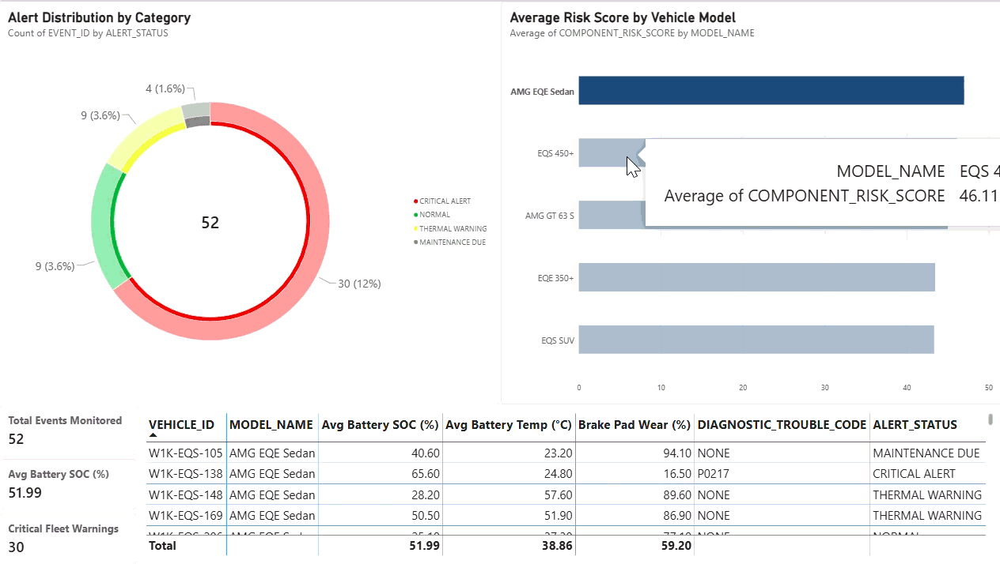
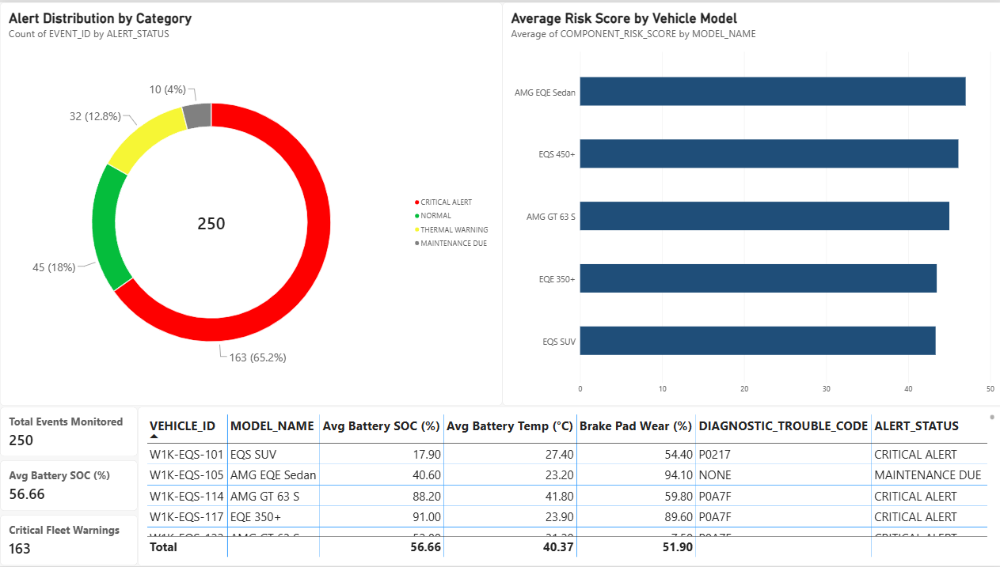

# Mercedes-Fleet-Telemetry-Analytics

An end-to-end Power BI telemetry analytics and fleet reliability solution built for monitoring real-time IoT diagnostic data across **Mercedes-Benz Electric Vehicles (Mercedes-EQ)**.

---

## 📊 Executive Dashboard Preview



*Figure 1: Interactive telemetry filtering across high-voltage battery health, thermal warnings, and DTC diagnostic alerts.*

---

## 📌 Project Overview
Modern electric vehicle fleets produce thousands of real-time telemetry records every second. This project delivers an executive and operational analytics dashboard designed to monitor vehicle battery status, track diagnostic trouble codes (DTCs), and identify high-risk models before component failures occur.

### Core Business Objectives:
* **Predictive Maintenance:** Identify vehicles operating under elevated battery temperatures or high brake pad wear.
* **Alert Escalation:** Categorize critical vehicle telemetry events to prioritize fleet technician dispatch.
* **Fleet Risk Benchmarking:** Compare component risk scores across Mercedes-EQ models (`AMG EQE Sedan`, `EQS 450+`, `AMG GT 63 S`, `EQE 350+`, `EQS SUV`).

---

## 🛠️ Data Architecture & Tech Stack
* **Business Intelligence & Visualization:** Microsoft Power BI Desktop
* **Data ETL & Transformation:** Power Query (Data Type Coercion, Schema Validation, Custom Columns)
* **Analytical Modeling:** DAX (Data Analysis Expressions)
* **Programming & Database:** Python, SQL

---

## 📸 Key Metrics & Visualizations



1. **Executive KPI Summary Cards:**
   * **Total Events Monitored:** Total diagnostic telemetry signals logged across the fleet.
   * **Avg Battery SOC (%):** Fleet-wide high-voltage battery State of Charge.
   * **Critical Fleet Warnings:** High-priority active vehicle diagnostic alerts.

2. **Alert Distribution (Donut Chart):**
   * **Critical Alert (Red):** Severe diagnostic failures (e.g., DTC `P0A7F` - EV Battery Pack Deterioration).
   * **Thermal Warning (Yellow):** Elevated battery core temperature warnings (`P0217`).
   * **Normal (Green):** Standard operational parameters.
   * **Maintenance Due (Gray):** Scheduled mechanical servicing flags.

3. **Risk Score Breakdown by Vehicle Model (Bar Chart):**
   * Isolates average component risk scores across vehicle models to detect potential batch manufacturing or software issues.

4. **Granular Telemetry Grid (Detailed Table):**
   * Drill-down view by `VEHICLE_ID` detailing battery percentage, temperature in Celsius, brake pad wear percentage, active DTCs, and current alert status.

---

## 💡 Key Fleet Insights
* **Battery Deterioration Primary Driver:** Over 65% of recorded events fell into the **Critical Alert** category, driven primarily by code `P0A7F` (EV Battery Pack Deterioration).
* **Cross-Model Consistency:** Average risk scores across all Mercedes-EQ models remained tightly clustered ($\approx 43 - 47$), indicating fleet-wide telemetry thresholds rather than isolated model defects.
* **Thermal Correlative Risk:** High battery temperatures directly correlate with active DTC triggers, underscoring the importance of thermal management in EV reliability.

---

## 📁 Repository Structure
```text
Mercedes-Fleet-Telemetry-Analytics/
├── Mercedes_EV_Fleet_Monitoring_Dashboard.pbix         # Interactive Power BI File
├── Mercedes_Fleet_Setup_2026-10-14-1321.csv           # Raw EV Telemetry Dataset
├── Mercedes_Telemetry_Ingestion.py                     # Data Ingestion Script
├── Mercedes_Fleet_Setup.sql                           # Relational Database Schema
├── Mercedes_fleet_monitoring_live_dashboard_demo.gif # Dashboard Animation
└── Mercedes_fleet_monitoring_dashoboard.png           # Dashboard Screenshot
